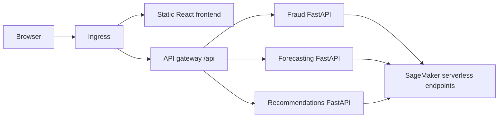

# Assessment IV ML Platform

This project combines local model training, containerized inference APIs, an operations dashboard, and AWS deployment through ECR, EKS, and SageMaker serverless hosting.

**Recorded deployment evidence:** the October 2026 verification documentation records three InService SageMaker endpoints and real predictions through the deployed frontend/API path using `MODEL_PROVIDER=sagemaker`. These are saved results, not a live status check. See [verification results](docs/live-integration-verification.json), [ownership inventory](docs/aws-resource-ownership.json), and [deployment instructions](docs/sagemaker-deployment.md). Project-managed Terraform and SageMaker/IAM resources use owner tags; the inventory documents ownership of AWS-managed resources.

With ingress configured, the application serves user-entered requests through this path:



The checked-in Kubernetes configuration uses the `sagemaker` provider: FastAPI services invoke the three real SageMaker serverless endpoints. The existing trained artifacts execute inside SageMaker hosting containers. The `local` provider remains available for development and tests. Responses identify the model and provider. DynamoDB stores successful prediction history; inference remains available if history storage fails. No application API key is required. The CSV catalog supplies training-compatible recommendation category/item codes, not fixed predictions.

`apps/services/` is canonical. Legacy `services/` entry points delegate to it. All Docker builds use the repository root as context. Models were saved with scikit-learn 1.6.1; runtime dependencies preserve that version. Recommendation preprocessing assumes the checked-in catalog matches the training dataset. If retraining, preserve encoders alongside the new artifact.

## Project scope and layout

- `apps/services/`: fraud detection, forecasting, and recommendations APIs, plus shared inference, validation, metadata, and request logging.
- `apps/gateway/`: routes requests to the appropriate service and aggregates downstream readiness.
- `dashboard/frontend/`: React/Vite dashboard with prediction forms, team ownership, model/service versions, provider details, and separate health, readiness, and metadata checks. Checks poll independently every 15 seconds after completion, with timeouts and failure isolation.
- `data/raw/`, `ml/training/`, and `ml/models/`: training CSVs, reproducible training scripts, and packaged joblib artifacts.
- `ml/serving/`: SageMaker hosting container implementing `/ping` and `/invocations`; one shared image selects a model through `SERVICE_NAME`.
- `terraform/cloudwatch/`: independent observability configuration for EKS log collection, Container Insights, a project dashboard, and alarms.
- `terraform/dynamodb/`: independent Terraform configuration/state for the prediction-history table and partition-scoped workload permissions.
- `terraform/`: AWS foundation including VPC, public subnets, routing, IAM roles, EKS control plane/managed nodes, and ECR repositories.
- `k8s/`: four team/platform namespaces, ConfigMaps, service accounts, deployments, services, ingress, resource quotas, and container limits. The fraud HPA manifest is optional and is not applied by `deploy.sh`.
- `scripts/`, `tests/`, and `.github/workflows/`: build/deployment tools, direct and end-to-end verification, Python/frontend tests, and CI/CD.

Terraform manages the foundation. `deploy_sagemaker.py` separately provisions hosting endpoints, scoped IAM roles, and EKS Pod Identity. `build.sh` and `deploy.sh` publish and deploy application images against existing infrastructure. The [rebuild runbook](docs/teardown-rebuild-runbook.md) coordinates the full lifecycle.

## Prediction history

All three services save successful prediction inputs, results, request IDs, and timestamps to DynamoDB. Open **Recent prediction history** below a prediction form and click **Load recent predictions** to retrieve its latest records. History is shared across users of this assessment application; it is not a private per-user account feature.

Writes run as best-effort background tasks after the prediction response. They do not affect inference readiness and are not retried or durably queued; a process restart or storage outage can lose a history record. History reads return an error if storage is unavailable. Records have a 30-day TTL; expired records are hidden while DynamoDB deletion completes.

Local development defaults to history disabled. The deployed ConfigMaps enable `PREDICTION_HISTORY_ENABLED` and set `PREDICTION_HISTORY_TABLE`. Provision storage before deploying those settings using [DynamoDB setup and verification](docs/dynamodb-prediction-history.md).

## Models and retraining

| Service | Training data in `data/raw/` | Model and evaluation |
| --- | --- | --- |
| Fraud | `fraud_assessment_dataset.csv` | Random Forest classifier using amount, transaction count, and account age; held-out accuracy |
| Forecasting | `forecasting_data.csv` | Random Forest regressor using three lagged values; held-out mean absolute error |
| Recommendations | `recommendations_data.csv` | Random Forest classifier predicting clicks from user/category/item codes; held-out accuracy; inference ranks catalog candidates by click probability |

Training runs locally, without a SageMaker training job. Each script uses a seeded 80/20 split and writes its artifact to `ml/models/`. Forecasting currently uses a random split of lagged rows; its reported MAE is not a chronological backtest or a guarantee of future performance.

After installing the Python dependencies, retrain from the repository root:

```bash
.venv/bin/python ml/training/train_fraud_model.py
.venv/bin/python ml/training/train_forecasting_model.py
.venv/bin/python ml/training/train_recommendations_model.py
```

These commands overwrite the packaged artifacts. Recommendation training currently saves the model without separate encoders; keep catalog/category codes consistent and preserve encoders if changing preprocessing. Run validation after retraining. Local-provider images must be rebuilt to include new artifacts; SageMaker also needs a rebuilt hosting image and an explicit endpoint release lifecycle. Application image deployment alone does not update hosted models. Follow the rebuild runbook for the supported teardown/rebuild workflow.

## Validate locally

Use Python 3.11 and Node 22 (the CI version). Commands below start at the project repository root.

```bash
python3.11 -m venv .venv
.venv/bin/python -m pip install -r requirements.txt
.venv/bin/python -m pytest -q apps tests
cd dashboard/frontend
npm ci
npm run build
npm run lint
npm test
```

The validation block ends in `dashboard/frontend`; return to the repository root before starting the APIs. For development, leave `MODEL_PROVIDER` unset or set it to `local`, and run each command in a separate terminal from the repository root:

```bash
.venv/bin/uvicorn apps.services.fraud.main:app --port 8001
.venv/bin/uvicorn apps.services.forecasting.main:app --port 8002
.venv/bin/uvicorn apps.services.recommendations.main:app --port 8003
FRAUD_SERVICE_URL=http://127.0.0.1:8001 FORECASTING_SERVICE_URL=http://127.0.0.1:8002 RECOMMENDATIONS_SERVICE_URL=http://127.0.0.1:8003 .venv/bin/uvicorn apps.gateway.main:app --port 8000
```

Run `npm run dev` in `dashboard/frontend`. Vite proxies `/api` to the gateway. Production uses the hosted nginx frontend and either a public Service or ingress.

## Deploy to existing AWS infrastructure

Prerequisites you must configure:

- Authenticated AWS CLI credentials with ECR push and EKS access; prefer your existing SSO/profile. Do not put access keys in application manifests.
- Existing `anthony-assessment4-eks` cluster and the three `anthony-assessment4-{fraud,forecasting,recommendations}` repositories in `us-east-1`.
- Three provisioned SageMaker endpoints and workload identity when using the checked-in `sagemaker` provider. Follow the [rebuild runbook, section 6](docs/teardown-rebuild-runbook.md#6-rebuild-and-deploy-sagemaker-hosting) to build hosting, provision, check status, and verify predictions before application deployment.
- Provisioned DynamoDB history table and scoped IAM policies for the enabled history settings; see [storage setup](docs/dynamodb-prediction-history.md).
- Public exposure (optional): either an existing nginx ingress controller, or the optional public frontend Service below. The frontend nginx server proxies `/api/` to the gateway, so an ingress controller is not required for the public-Service option.
- Docker Desktop running with Buildx, kubectl, and the validated Python environment.

Read-only checks:

```bash
export AWS_REGION=us-east-1
aws sts get-caller-identity
bash scripts/bootstrap.sh
aws ecr describe-repositories --region us-east-1 --repository-names anthony-assessment4-fraud anthony-assessment4-forecasting anthony-assessment4-recommendations
```

For an application release outside an ongoing rebuild, choose a unique tag and deploy:

```bash
export IMAGE_TAG="app-$(date -u +%Y%m%dT%H%M%SZ)"
bash scripts/build.sh
bash scripts/deploy.sh
```

During a teardown/rebuild cycle, keep the tag selected in section 6. If the terminal was reopened, restore the saved variables before building:

```bash
export CYCLE_DIR=$(cat .presentation-backups/current-cycle-path.txt)
source "$CYCLE_DIR/session.env"
echo "$IMAGE_TAG"
bash scripts/build.sh
bash scripts/deploy.sh
```

This assumes the runbook already saved `session.env`; if it is missing, use the runbook's recovery instructions. Do not choose a new SageMaker release simply because a terminal session ended.

The application build/deploy scripts never create/delete clusters or repositories and never run Terraform apply/destroy. Gateway and frontend images reuse the fraud repository with distinct `gateway-` and `frontend-` tag prefixes. Set `ECR_PREFIX`, `AWS_ACCOUNT_ID`, or `EKS_CLUSTER_NAME` if existing resource names differ. Rendered images are applied directly, avoiding a rollout to stale v1 images first. Tests run before Kubernetes changes. Placeholder secrets are no longer mounted or applied.

To access the deployed frontend without a public load balancer, keep this command running in a separate terminal:

```bash
kubectl -n platform-team port-forward --address 127.0.0.1 svc/frontend-service 8080:80
```

Open `http://127.0.0.1:8080`. The frontend, gateway, and APIs run in EKS, and inference runs in SageMaker; the laptop tunnels the connection. No local Vite process is needed.

For public access, check existing exposure first rather than assuming an ingress controller or load balancer exists. The following optional action creates an AWS load balancer and can incur AWS charges:

```bash
kubectl apply -f k8s/exposure/frontend-public.yaml
kubectl -n platform-team get service frontend-public --watch
```

Once `EXTERNAL-IP` contains a hostname, open `http://HOSTNAME` in your browser. The static frontend server forwards `/api/` to the deployed gateway. If you already configure a working ingress controller separately, the included ingress manifests provide the same paths.

Open the frontend public address in a browser. Use the forms and inspect `/api/fraud/predict`, `/api/forecasting/predict`, or `/api/recommendations/predict` in the network panel. Each successful response includes a request ID header, live provider/model output, and measured browser request duration.

A gateway port-forward plus Vite development proxy can also diagnose API issues, but use the frontend Service port-forward above to demonstrate the deployed frontend.

```bash
kubectl get pods,services,ingress -A
kubectl -n platform-team logs deployment/gateway-service
curl http://YOUR_PUBLIC_ADDRESS/api/ready
curl -X POST http://YOUR_PUBLIC_ADDRESS/api/fraud/predict -H 'Content-Type: application/json' -d '{"amount":1800,"transaction_count":35,"account_age_days":12}'
```

CI/CD uses existing GitHub secrets `AWS_ACCESS_KEY_ID` and `AWS_SECRET_ACCESS_KEY`. Configure those only if using automatic deployment; local deployment can use your AWS profile. The workflow pushes/deploys on main/master after checks. It does not provision infrastructure.

## SageMaker endpoint configuration

The hosting container serves each service's JSON request/response contract. See `docs/sagemaker-deployment.md` for resource names and repeatable provisioning. Set `MODEL_PROVIDER=sagemaker`, `AWS_REGION=us-east-1`, and the corresponding `FRAUD_SAGEMAKER_ENDPOINT`, `FORECASTING_SAGEMAKER_ENDPOINT`, or `RECOMMENDATIONS_SAGEMAKER_ENDPOINT` in its ConfigMap. Responses must match the service response schema (provider is added by the adapter layer). No generic endpoint format is assumed.

Use an EKS workload IAM role through Pod Identity or IRSA granting `sagemaker:InvokeEndpoint` on the specific endpoint ARN. No static AWS keys belong in these manifests. This IAM setup is unnecessary for the default packaged-model path.

`/health` checks process liveness. `/ready` checks loaded local artifacts or required SageMaker configuration; it does not prove a remote endpoint is reachable or IAM access works. The gateway readiness checks all downstream readiness routes. SageMaker connect/read timeouts are 3/70 seconds. SDK retries are disabled; the adapter retries once after 250 ms only for specific model-not-ready/no-response failures occurring within one second. Other remote authentication, availability, and model-server failures become sanitized 502 responses, while recognized invalid-input ModelErrors become 422 responses. There is no fallback to local inference. Serverless cold starts can delay or temporarily fail a prediction; check endpoint status before retrying verification.

Confirm existing Terraform state and resources before planning any infrastructure updates. Application integration does not require recreating VPC, EKS, node groups, or ECR.

See [Kubernetes deployment and verification](docs/kubernetes-deployment.md) for namespace separation, admission checks, probe semantics, and the deployed frontend access command.

See [operations dashboard requirements and verification](docs/dashboard-operations.md) for API metadata, independent live polling, and failure isolation.

For presentation preparation, see the [simplified file-by-file code talking points](docs/project-code-talking-points.md).

For a complete presentation teardown and rebuild cycle, follow the [destroy/rebuild runbook](docs/teardown-rebuild-runbook.md). It covers SageMaker cleanup, Terraform plans, image builds, workload identity, deployment, and live verification.

## CloudWatch monitoring

EKS application logs and Container Insights metrics are collected by the CloudWatch Observability add-on using Pod Identity. All five control-plane log types are enabled. The project dashboard and 12 alarms cover API/history errors, SageMaker failures/latency, DynamoDB throttling, and node utilization. EKS log retention is 14 days. SNS alarm actions target the project topic with an email subscription; AWS requires recipient confirmation before email delivery. See [CloudWatch operations](docs/cloudwatch-operations.md) for access, thresholds, verification, and rebuild instructions.
