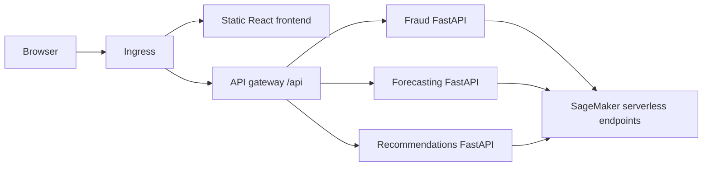

# Assessment IV ML Platform

**Live deployment:** all three SageMaker endpoints are InService, EKS workloads use `MODEL_PROVIDER=sagemaker`, and the deployed frontend/API path has been verified with real predictions. [Verification results](docs/live-integration-verification.json), [ownership inventory](docs/aws-resource-ownership.json), and [deployment instructions](docs/sagemaker-deployment.md). Every new AWS resource has `Owner=anthony`.

The deployed application serves user-entered requests through this path:



Kubernetes uses the `sagemaker` provider: FastAPI services invoke the three real SageMaker serverless endpoints. The existing trained artifacts execute inside SageMaker hosting containers. The `local` provider remains available for development and tests. Responses identify the model and provider. No database or application API key is required. The CSV catalog supplies training-compatible recommendation category/item codes, not fixed predictions.

`apps/services/` is canonical. Legacy `services/` entry points delegate to it. All Docker builds use the repository root as context. Models were saved with scikit-learn 1.6.1; runtime dependencies preserve that version. Recommendation preprocessing assumes the checked-in catalog matches the training dataset. If retraining, preserve encoders alongside the new artifact.

## Validate locally

```bash
python3.11 -m venv .venv
.venv/bin/python -m pip install -r requirements.txt
.venv/bin/python -m pytest -q apps tests
cd dashboard/frontend
npm ci
npm run build
npm run lint
```

For development, run each command in a separate terminal from the repository root:

```bash
.venv/bin/uvicorn apps.services.fraud.main:app --port 8001
.venv/bin/uvicorn apps.services.forecasting.main:app --port 8002
.venv/bin/uvicorn apps.services.recommendations.main:app --port 8003
FRAUD_SERVICE_URL=http://127.0.0.1:8001 FORECASTING_SERVICE_URL=http://127.0.0.1:8002 RECOMMENDATIONS_SERVICE_URL=http://127.0.0.1:8003 .venv/bin/uvicorn apps.gateway.main:app --port 8000
```

Run `npm run dev` in `dashboard/frontend`. Vite proxies `/api` to the gateway. Production uses the hosted nginx frontend and either a public Service or ingress.

## Deploy to existing AWS infrastructure

Prerequisites you must configure:

- Authenticated AWS CLI credentials with ECR push and EKS access; prefer your existing SSO/profile. Do not put access keys in application manifests.
- Existing `anthony-assessment4-eks` cluster and the three `anthony-assessment4-{fraud,forecasting,recommendations}` repositories in `us-east-1`.
- Public exposure: either an existing nginx ingress controller, or the optional public frontend Service below. The frontend nginx server proxies `/api/` to the gateway, so an ingress controller is not required for the public-Service option.
- Docker Desktop running with Buildx, kubectl, and the validated Python environment.

Read-only checks:

```bash
export AWS_REGION=us-east-1
aws sts get-caller-identity
bash scripts/bootstrap.sh
aws ecr describe-repositories --region us-east-1 --repository-names anthony-assessment4-fraud anthony-assessment4-forecasting anthony-assessment4-recommendations
```

Build and deploy a unique release:

```bash
export IMAGE_TAG=integration-v2
bash scripts/build.sh
bash scripts/deploy.sh
```

The scripts never create/delete clusters or repositories and never run Terraform apply/destroy. Gateway and frontend images reuse the fraud repository with distinct `gateway-` and `frontend-` tag prefixes. Set `ECR_PREFIX`, `AWS_ACCOUNT_ID`, or `EKS_CLUSTER_NAME` if existing resource names differ. Rendered images are applied directly, avoiding a rollout to stale v1 images first. Tests run before Kubernetes changes. Placeholder secrets are no longer mounted or applied.

**Verified during this update:** the cluster is active and the three repositories exist, but there is no ingress controller or public load balancer. After deploying, you must expose the hosted frontend. The following optional action creates an AWS load balancer and can incur AWS charges; it does not recreate existing infrastructure:

```bash
kubectl apply -f k8s/exposure/frontend-public.yaml
kubectl -n platform-team get service frontend-public --watch
```

Once `EXTERNAL-IP` contains a hostname, open `http://HOSTNAME` in your browser. The static frontend server forwards `/api/` to the deployed gateway. If you already configure a working ingress controller separately, the included ingress manifests provide the same paths.

Open the frontend public address in a browser. Use the forms and inspect `/api/fraud/predict`, `/api/forecasting/predict`, or `/api/recommendations/predict` in the network panel. Each successful response includes a request ID header, live provider/model output, and measured browser request duration.

If ingress is unavailable, temporarily validate **deployed** workloads using a gateway port-forward plus Vite's development proxy; this is a diagnostic, not the hosted frontend demonstration.

```bash
kubectl get pods,services,ingress -A
kubectl -n platform-team logs deployment/gateway-service
curl http://YOUR_PUBLIC_ADDRESS/api/ready
curl -X POST http://YOUR_PUBLIC_ADDRESS/api/fraud/predict -H 'Content-Type: application/json' -d '{"amount":1800,"transaction_count":35,"account_age_days":12}'
```

CI/CD uses existing GitHub secrets `AWS_ACCESS_KEY_ID` and `AWS_SECRET_ACCESS_KEY`. Configure those only if using automatic deployment; local deployment can use your AWS profile. The workflow pushes/deploys on main/master after checks. It does not provision infrastructure.

## SageMaker endpoint configuration

The deployed endpoints now serve each service's JSON request/response contract. See `docs/sagemaker-deployment.md` for resource names and repeatable provisioning. Set `MODEL_PROVIDER=sagemaker`, `AWS_REGION=us-east-1`, and the corresponding `FRAUD_SAGEMAKER_ENDPOINT`, `FORECASTING_SAGEMAKER_ENDPOINT`, or `RECOMMENDATIONS_SAGEMAKER_ENDPOINT` in its ConfigMap. Responses must match the service response schema (provider is added by the adapter layer). No generic endpoint format is assumed.

Use an EKS workload IAM role through Pod Identity or IRSA granting `sagemaker:InvokeEndpoint` on the specific endpoint ARN. No static AWS keys belong in these manifests. This IAM setup is unnecessary for the default packaged-model path.

`/health` checks process liveness. `/ready` checks loaded local artifacts or required SageMaker configuration; it does not prove a remote endpoint is reachable or IAM access works. The gateway readiness checks all downstream readiness routes. SageMaker connect/read timeouts are 3/70 seconds, with one attempt; errors become sanitized 502 responses and never fall back to local inference.

The checked-in Terraform foundation is unchanged. Confirm existing state and resources before planning any infrastructure updates. Application integration does not require recreating VPC, EKS, node groups, or ECR.

See [Kubernetes deployment and verification](docs/kubernetes-deployment.md) for namespace separation, admission checks, probe semantics, and the deployed frontend access command.

See [operations dashboard requirements and verification](docs/dashboard-operations.md) for API metadata, independent live polling, and failure isolation.

For presentation preparation, see the [simplified file-by-file code talking points](docs/project-code-talking-points.md).

For a complete presentation teardown and rebuild cycle, follow the [destroy/rebuild runbook](docs/teardown-rebuild-runbook.md). It covers SageMaker cleanup, Terraform plans, image builds, workload identity, deployment, and live verification.
